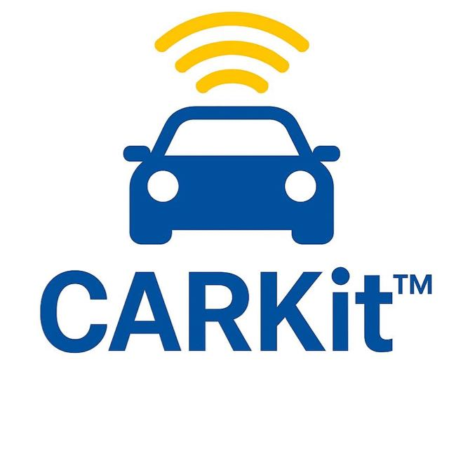

<div align="center">
  
  
  <a href="https://www.thecarlab.org/">The CAR Lab</a>
</div>

**CARKit** is a modular ROS 2 middleware platform for autonomous driving education, developed by the Connected and Autonomous Research (CAR) Lab at the University of Delaware for ADA Academy and Intro2AV.

Designed around real autonomous vehicle workflows, CARKit provides a unified software stack for perception, navigation, planning, and control on small-scale Ackermann vehicles. The platform combines industry-standard ROS 2 tools with hands-on deployment on physical vehicles and simulation environments, enabling students to learn autonomous systems through practical experimentation.

## 🧩 Supported Platforms

- 🚀 NVIDIA Jetson Orin Nano (`aarch64`). The current vehicle deployment is
  validated on Jetson Linux R39.2.1.
- 📦 The published container uses NVIDIA L4T JetPack `r36.4.0` (JetPack
  6.1 userspace), Ubuntu 22.04, ROS 2 Humble, CUDA, and TensorRT.
- 🐳 Docker Engine with the
  [NVIDIA Container Toolkit](https://docs.nvidia.com/datacenter/cloud-native/container-toolkit/latest/install-guide.html)
  on the Jetson host.
- 🏎️ OSRacer chassis, LakiBeam lidar, UVC camera, and a CUDY router
  providing the vehicle's private `192.*` network.
- 🏎️ F1TENTH/VESC chassis, Hokuyo URG lidar, Intel RealSense camera,
  and a Jetson connected directly to eduroam with a `128.*` address.
- 🛰️ The generic navigation package also retains serial SLLidar/RPLIDAR
  support for other course vehicles.
- 🌐 A current Chromium, Chrome, Firefox, or Safari browser. The native bridge
  accepts up to five simultaneous WebUI clients by default.

ROS 2 and CARKit dependencies run inside `ariiees/carkit:latest`. The host
only needs compatible Jetson Linux, Docker, Git, and hardware access for the
selected chassis. ROS 2 Desktop, RViz, and rqt remain available inside the
image for debugging, but no ROS GUI is started automatically. The normal
interface is the lightweight CARKit WebUI on port `8080`. It draws the map,
path, lidar, camera/perception results, and Jetson/chassis telemetry through
the native C++ CARKit WebSocket bridge.

## ⚙️ Setup

### One-command Jetson setup

For **ADA2's VESC + RPLidar S3M1-R2 + RealSense D435i**, use the additional
`vesc_rplidar` selection:

```bash
./docker/setup_jetson.sh ADA2 vesc_rplidar
```

Then select **VESC + RPLidar + RealSense** in the WebUI and click
**Install / build selected chassis**. See the
[ADA2 setup and calibration instructions](docs/vesc_rplidar_setup.md).
The OSRacer and legacy F1TENTH instructions below remain available.

On a fresh Jetson, clone the `ada2026` branch and run the setup script once.
Pass the vehicle's ADA number and chassis:

```bash
git clone --branch ada2026 https://github.com/thecarlab/CARKit.git ~/CARKit
cd ~/CARKit
./docker/setup_jetson.sh ADA5 f1tenth
```

For an OSRacer, use its own ADA number and `osracer`:

```bash
./docker/setup_jetson.sh ADA1 osracer
```

The first run asks for the CARLab monitor token with hidden input. Obtain it
from the CARLab administrator. It is stored only in the root-readable
`/etc/carkit-webmonitor.env` file and is reused automatically on later setup
runs. It is deliberately not committed to this public repository, because
that would let anyone overwrite vehicle addresses.

`setup_jetson.sh` performs the complete host setup:

- installs missing Docker, Python, and HTTPS client packages;
- enables Docker and configures the NVIDIA container runtime;
- pulls `ariiees/carkit:latest`;
- installs OSRacer USB, camera, and LakiBeam network rules when applicable;
- repairs the Richbeam network binding before every container start, even when
  its MAC-derived Linux interface name changes;
- installs and enables the CARKit container/WebUI boot service;
- installs and enables the authenticated IP reporter; and
- starts both services and waits until the WebUI answers on port `8080`.

The script is safe to run again after updating the checkout. If the vehicle
and chassis arguments are omitted, it reuses the existing configuration or
prompts for the missing values:

```bash
./docker/setup_jetson.sh
```

After setup, open the public
[CARLab ADA Fleet Monitor](https://carlab-ada-monitor.udcarlab.chatgpt.site).
The selected vehicle appears there as online with its current WebUI address.
The reporter sends an update immediately after startup and every hour. If the
vehicle is offline, it retries every five minutes for at most 20 consecutive
attempts, then stops until the reporter service or vehicle is restarted. This
avoids continual internet traffic when the vehicle is intentionally operating
only on a local network.

On the computer or tablet used to view an OSRacer:

1. Connect to the vehicle's **OSR Wi-Fi** network. The OSRacer Jetson reaches
   that network through its CUDY router and receives a private `192.*` address.
2. Open the vehicle from the fleet monitor, select **OSRacer**, and click
   **Install / build selected chassis**. Do not use the LakiBeam interface's
   `192.168.8.*` address.

The viewing device must remain on the OSR Wi-Fi network while using the
OSRacer WebUI.

On the computer or tablet used to view a F1TENTH:

1. Connect to **eduroam**. The F1TENTH Jetson is connected directly to
   eduroam and receives a `128.*` address.
2. Open the vehicle from the fleet monitor, select **F1TENTH**, and click
   **Install / build selected chassis**. This fetches the pinned F1TENTH/VESC
   sources when they are absent and builds the F1TENTH adapter.

The viewing device must remain on eduroam while using the F1TENTH WebUI.

For either chassis, the dashboard lets you choose the course profile,
independently override each algorithm, select startup components, launch,
stop, and inspect live results. The **Code editor** provides a read-only view
of the component-scoped reference implementation plus editable ADA and
Intro2AV workspaces, a file explorer, syntax diagnostics, and collaborative
editing for up to five users. The **Compile** page can
rebuild the entire repository or only perception, localization, control, or
planning. The next launch automatically sources the updated install overlay.

### Service management

The setup command enables both services at boot. They do not require a GNOME
login. Useful commands:

```bash
systemctl status carkit carkit-webmonitor
sudo systemctl restart carkit
sudo systemctl restart carkit-webmonitor
sudo systemctl stop carkit
journalctl -u carkit -f
journalctl -u carkit-webmonitor -f
```

To use a shell while the boot service or foreground WebUI is running:

```bash
docker exec -it carkit bash
```

To run only a shell with no WebUI, stop the service first:

```bash
sudo systemctl stop carkit
./docker/run_jetson.sh bash
```

Then, inside that container shell, use the command for the selected chassis.
For OSRacer:

```bash
./docker/install_carkit.sh osracer
```

For F1TENTH:

```bash
./docker/install_carkit.sh f1tenth
```

`install_carkit.sh` records the selected chassis in `.carkit/config.json`,
fetches the pinned optional F1TENTH source when needed, and builds the mounted
workspace at `/workspaces/CARKit`.

## 🎓 Course Profiles

- `reference`: native C++ planning, behavior, localization adapters, and
  control; Python is retained only for YOLO/TensorRT perception.
- `ada_high_school`: working guided planning, control, and perception from the
  student-owned `carkit_ada_academy` package.
- `intro2av`: safe ROS 2 boilerplates for planning, control, and perception in
  both Python and C++; topic names, timers, and the safety boundary remain.

Behavior planning remains enabled for every profile and lives in the planning
layer. Course selection changes planning, control, and perception ownership
together; each ownership selector can still override one component without
modifying the reference source.

Switching a component in the WebUI never copies over the reference source.
Student work lives in the separate `carkit/education/carkit_ada_academy`,
`carkit/education/carkit_intro2av`, and `carkit_intro2av_cpp` packages;
reference implementations stay in their production packages. Changing the
course selector chooses Intro2AV Python initially, while each Algorithm
Ownership selector can independently switch to Intro2AV C++. See
[`docs/course_profiles.md`](docs/course_profiles.md).

### Using the WebUI

Use the chassis-specific network described during installation: connect the
viewing device to **OSR Wi-Fi** and open the OSRacer's `192.*` address, or
connect it to **eduroam** and open the F1TENTH vehicle's `128.*` address. The
Overview provides the map, LiDAR, perception overlay, launch controls,
telemetry, and goal/pose tools without an RViz or Foxglove process.

To localize the vehicle, click **Set initial pose**, press on its current map
position, drag toward the vehicle's forward direction, and release. Goal poses
use the same position-and-heading gesture. Drag the map to rotate, Shift-drag
to pan, and use the mouse wheel to zoom.

USB reminder before launching sensors:

- Connect the OSRacer USB hub and verify the UVC camera alias. The LakiBeam is
  exposed over USB Ethernet at `192.168.8.2`; the setup script assigns its
  Richbeam adapter `192.168.8.1/24` with no default route.
- On the Jetson host, confirm the devices and direct LiDAR route before launch:

```bash
lsusb -t
ls -l /dev/osrbot_base /dev/osrbot_usb_cam
ip -4 -brief address
ip route get 192.168.8.2
ping -c 1 192.168.8.2
```

The direct `ros2` examples below are advanced alternatives to the WebUI. Run
them from a shell inside the active container (`docker exec -it carkit bash`)
and stop any WebUI launch session that already owns the same hardware.

## 🕹️ Keyboard Driving And Autonomous Control

Sign in with the private `.carkit/access.key` file on the vehicle computer, then
select **Take control**. See [WebUI access and remote connections](docs/webui_access.md)
for SSH forwarding and explicit network binding.

Both chassis use **keyboard control by default** in the focused WebUI Overview:

- Hold **W / S** to move forward / reverse (up to 0.4 m/s).
- Hold **A / D** to steer left / right; combine with W or S to turn.
- Release the keys to stop. Leaving the window, opening the editor/configuration,
  or losing the connection stops manual motion; press the keys again to resume.
- Press **Caps Lock** once to enable or disable autonomous driving. The displayed
  mode comes from the control center; holding Caps Lock does not repeatedly toggle it.
- Press **Space** on Overview or **Ctrl + Shift + Space** from any page, or click
  the persistent **Emergency stop** button, to latch a stop. **Reset to manual**
  clears it without starting motion. Caps Lock cannot clear an emergency stop.

Typing in the code editor, terminal, or form fields does not drive the vehicle.
Only one browser can supply keyboard motion at a time. The arbiter remains active
in manual-only sessions, even when the **autonomous control** module is unchecked.
Joystick input is optional: select **Manual input → Joystick** before launching,
optionally customize the button mappings in the vehicle hardware profile, or pass
`manual_input:=joystick` to the integrated launch.

For a full reference navigation session inside the container:

```bash
ros2 launch carkit_bringup carkit.launch.py profile:=reference chassis:=osracer
# Or select chassis:=f1tenth / chassis:=vesc_rplidar for the VESC vehicles.
```

Open the WebUI, set the vehicle's initial pose, send a goal, and use Caps Lock to
switch to autonomous driving. Switching back to manual requires a new WASD press.
The selected course profile determines which planning and control algorithms run.
ADA algorithms now require fresh odometry and a valid transform between the goal,
path, and odometry frames; a map-frame goal needs a localization provider publishing
`map -> odom`. Missing feedback or transforms produce a stop, not an assumed pose.

For keyboard mapping, select the reference profile and use
`navigation_mode:=mapping`. Save the map from a container terminal:

```bash
ros2 run nav2_map_server map_saver_cli -f /workspaces/CARKit/map/test
```

Per-vehicle geometry, calibrated gains, device identifiers, mounting transforms,
and limits are in [the hardware profiles](carkit/core/carkit_bringup/config/hardware).
See [hardware profiles and safety validation](docs/hardware_profiles.md).
The conservative default forward limits are 0.8 m/s for OSRacer and the legacy
F1TENTH selection, and 0.5 m/s for VESC + RPLidar. Keyboard speed is additionally
limited to 0.4 m/s. Changes to a hardware profile are applied together to the
hardware driver, navigation, student control parameters, arbiter, and WebUI bridge.

### 👁️ Perception And Behavior

With the selected sensor bringup publishing the camera, start typed 2D YOLO
perception:

```bash
ros2 launch carkit_perception perception.launch.py
```

The WebUI shows the annotated perception stream directly. Its
configuration drawer can select generic COCO, traffic-sign-only, combined, or
a custom Jetson TensorRT model. Camera publication and perception inference
both target 10 Hz while discarding stale frames to keep the live view current.
In the map/lidar panel, drag to rotate,
Shift-drag to pan, use the mouse wheel to zoom, and double-click to reset.

Start behavior overrides separately:

```bash
ros2 launch carkit_behavior behavior_center.launch.py
```

Behavior logic only affects commands while the control center is in
`AUTO_DRIVE`.

## 🗂️ Repository Layout

```text
carkit/
  core/          one carkit_bringup entry point, profiles, stable interfaces
  education/     separate ADA Academy and Intro2AV algorithm packages
  interface/     WebUI, collaborative editor, and native C++ ROS bridge
  control/       human teleop and autonomous command safety arbiter
  planning/      scalable road-behavior planning rules
  navigation/    SLAM Toolbox, AMCL, Nav2, Twist-to-Ackermann bridge
  perception/    Python YOLO/TensorRT inference and typed 2D detections
  sensors/       camera, scan filter, sensor transforms, and vendor adapters
  vehicle/       OSRacer integration and pinned F1TENTH vendor selection
  tools/         classroom utilities and demos
map/             all occupancy maps
docker/          image, run, build, and publish scripts
docs/            troubleshooting and diagrams
```

All supported workflows start through one ROS entry point inside the one
`carkit` Docker container:

```bash
ros2 launch carkit_bringup carkit.launch.py \
  profile:=intro2av chassis:=f1tenth
```

Vendor package names such as `osracer_base`, `f1tenth_stack`, and `vesc_driver`
remain unchanged so upstream updates and licenses stay traceable. They are
isolated behind the CARKit launch and topic contract; optional F1TENTH sources
are fetched at their pinned revisions only when that chassis is installed.

## 📚 More Docs

- [Control](carkit/control/README.md)
- [Navigation](carkit/navigation/README.md)
- [Perception](carkit/perception/README.md)
- [Sensors](carkit/sensors/README.md)
- [Vehicle](carkit/vehicle/README.md)
- [Docker](docker/README.md)
- [Troubleshooting](docs/troubleshooting.md)
- [Architecture and course profiles](docs/course_profiles.md)
- [WebUI design](docs/webui_design.md)
